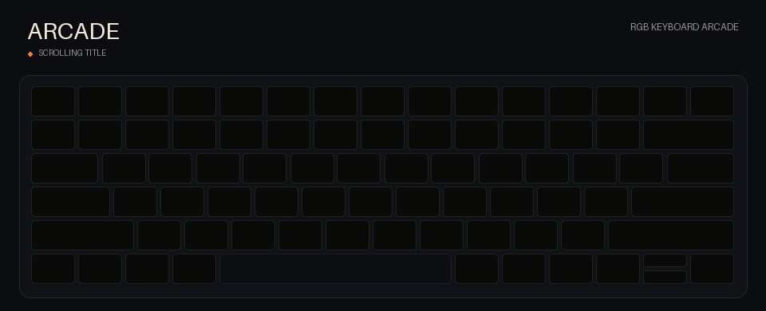
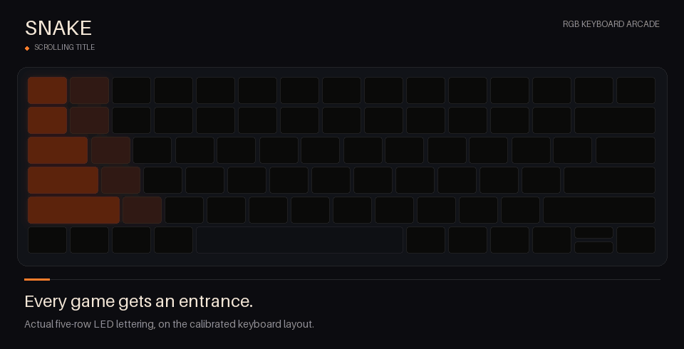
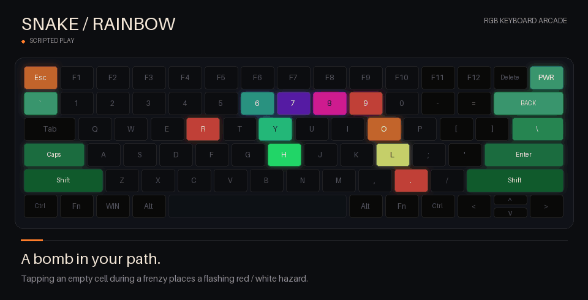
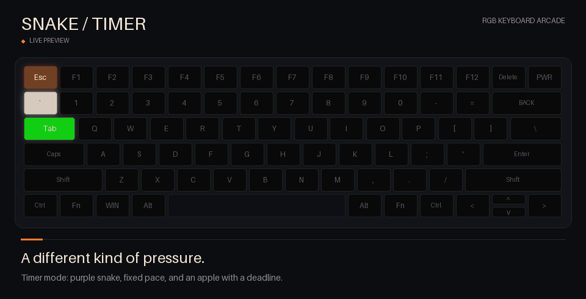
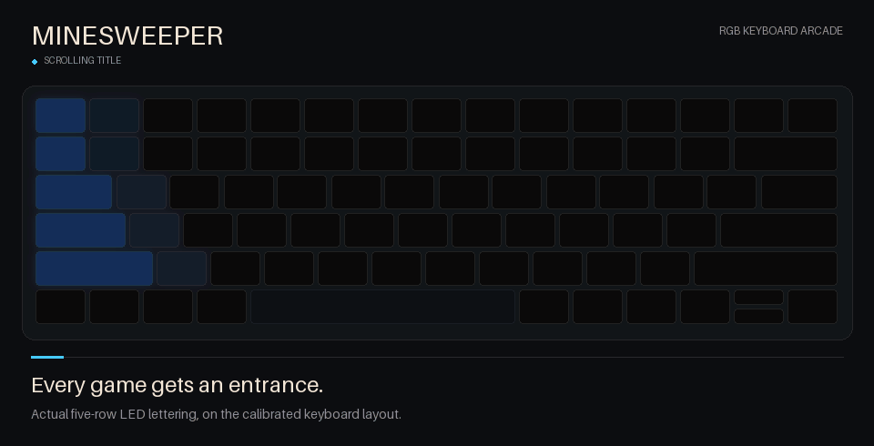
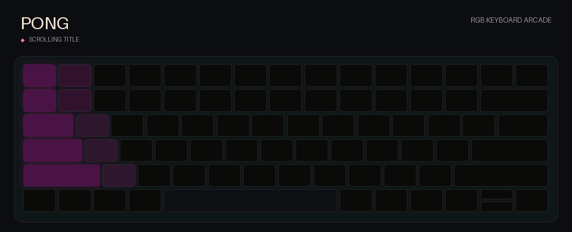

# rgb-keyboard-arcade

**The dumbest way to play video games with a computer.**

Play **Snake, Minesweeper, and Pong on a per-key RGB keyboard**. The keyboard is the display and controller: drifting previews, scrolling LED titles, ripple effects, three-point Pong scores, and increasingly unfortunate bomb placements.



This is the working Linux/OpenRazer version extracted from a personal desktop setup. **The UI is optional.** Start the daemon, bind one shortcut, and play on the keyboard. An independent Quickshell widget adds a live LED preview, Minesweeper numbers, game selection and settings; it does not replace your bar or wallpaper.

**Tested hardware:** Razer Blade 15 Advanced (Early 2022), US ANSI, USB `1532:028a`. Other keyboards, arbitrary layouts, Windows and macOS are not supported by this release. The game renderer can run without hardware for development, but the actual device/input integration is Linux-specific.

## Watch it play

These **20 fps renders use the actual game engine, animation timings, and calibrated key geometry**, with deterministic scripted inputs and added captions. They are not physical keyboard footage. Nothing speeds through an entry, explosion, or stage transition.

### Snake

The roaming preview bursts apart and springs into a fresh snake. Five real apple pickups trigger the rainbow wave; side LEDs become the countdown, then column shutters reveal the next palette. A head-to-tail death wave closes the round.



<details>
<summary>More Snake: rainbow explosions and Timer mode</summary>

**Rainbow death:** a tapped bomb triggers white ignition, spectrum shockwaves, and curved color sparks.



**Timer:** fixed pace, offset edge portals, and food that fades white → yellow → orange → red. Miss its deadline and the snake dissolves.



</details>

### Minesweeper

Tap and release to send a reveal wave through the board. Hold to flag. One wrong tap starts a chain detonation. Numbers below are the optional widget's clue overlay; the physical keyboard communicates clues through LED colors.



### Pong

Opposing paddles assemble the serve. Rallies leave trails and impact ripples; each point sends a scoring wave across the keys. The bottom modifiers tally the score. First to three gets the victory animation.



Prefer still images? [Arcade](docs/demos/arcade.png) · [Snake](docs/demos/snake.png) · [Rainbow effects](docs/demos/snake-frenzy.png) · [Timer](docs/demos/snake-timer.png) · [Minesweeper](docs/demos/minesweeper.png) · [Pong](docs/demos/pong.png). [Caption timings and captured engine phases](docs/demos/scenes.json).

## Try it without hardware

Requires Python 3.10+. From this checkout:

```sh
python -m venv .venv
.venv/bin/pip install --no-deps .
.venv/bin/rgb-keyboard-arcade serve --simulate
```

In another terminal:

```sh
.venv/bin/rgb-keyboard-arcade cycle-game   # enter, with ARCADE title
.venv/bin/rgb-keyboard-arcade cycle-game   # skip a title, or cycle games when none is showing
.venv/bin/rgb-keyboard-arcade status
.venv/bin/rgb-keyboard-arcade widget       # optional; requires Quickshell on Wayland
```

Simulation reads no keyboard events and writes no device LEDs. Use the widget to interact, or the [local JSON protocol](docs/protocol.md). Close the daemon with Ctrl+C.

## Use a real keyboard

1. Install and configure [OpenRazer](https://openrazer.github.io/) for your distribution. Its daemon must already detect your keyboard and allow per-key lighting as your normal user.
2. Install the distribution's Python OpenRazer client, `evdev`, and D-Bus Python bindings. Install this package with that same Python, or use a virtual environment with `--system-site-packages`. OpenRazer is a distribution dependency, not bundled here.
3. Ensure your user can read the matching keyboard's `/dev/input/event*` interfaces. See the [device-specific input permission example](examples/70-rgb-keyboard-arcade.rules). Do not run the arcade as root.
4. Stop other applications that continually write RGB effects to this keyboard, then run:

```sh
rgb-keyboard-arcade init-config
rgb-keyboard-arcade serve
```

5. Bind **Super+Escape** in your desktop to `rgb-keyboard-arcade cycle-game`. Use an absolute executable path if your desktop does not inherit the same PATH. An optional [Hyprland Lua example](examples/hyprland.lua) is included; other desktops can run the same command from their shortcut settings.

No installer changes system permissions, desktop configuration, autostart, or firmware. Start manually, or adapt the [optional user service](examples/rgb-keyboard-arcade.service). The current integration checks the graphical session's lock state through logind/D-Bus and releases gameplay on lock or suspend. This is a UI-free desktop daemon, not a tested bare-TTY game.

## Controls

| Key | Action |
| --- | --- |
| Super+Esc | Enter Arcade; cycle Snake → Minesweeper → Pong |
| Super+Esc while text scrolls | Skip into the current game's preview |
| Esc | Active → Passive preview → Default lighting |
| Backtick | Cycle the selected game's modes while in Passive |
| Tab | Cycle Easy / Medium / Hard / Expert while in Passive |

Escape breathes in the selected game's color. Tab's difficulty light appears only in the running preview. Game control keys use sequential rainbow hints. The desktop still receives ordinary typing during Passive; Active captures only the matched keyboard. Keys are not logged during ordinary play. The legacy explicit calibration mode alone can save a local movement capture.

**Snake:** arrows steer. Rainbow and Timer variants retain their own previews and effects. During Rainbow Passive or an Active rainbow frenzy, tapping an empty board cell creates a lethal red/white flashing bomb. Ordinary Active taps add apples. Every fifth apple is rainbow; five taps on an ordinary apple also upgrade it. Food pauses during a frenzy and its stage transition. Timer food fades white → yellow → orange → red; eat it before expiry. Timer wraps at edges; Rainbow has walls after the initial spawn shield.

**Minesweeper:** 58 playable keys. Tap and release to reveal; hold 450 ms to flag/unflag. First opening and its neighbors are safe. LEDs indicate clue values by color; the optional widget displays exact numbers. Easy through Expert use 6 / 9 / 12 / 15 mines. Random boards can require guesses. [Clue color guide](docs/configuration.md#minesweeper-colors).

**Pong:** solo against an AI, or two players. P1 uses Right Shift / Right Arrow for up/down; P2 uses Left Shift / Left Ctrl. Difficulty sets ball speed, and solo AI movement also scales. First to **three** wins. P2/AI scores fill Left Fn → Super → Left Alt; P1 scores fill Right Alt → Right Fn → Right Ctrl. Unscored LEDs stay off. Holding moves continuously; release stops movement.

## Configure it

Edit `~/.config/rgb-keyboard-arcade/config.json`, or use `--config /path/to/config.json` **before the subcommand**. [Example configuration](examples/config.json) and [configuration notes](docs/configuration.md) cover key binds, shortcut matching, reduced motion, device name, socket, and the optional client-presence guard. Restart the daemon after editing.

Game/variant/difficulty preferences are saved separately under `$XDG_STATE_HOME/rgb-keyboard-arcade/`. Closing the widget does not end a match by default. `rgb-keyboard-arcade mode default` releases capture and restores the hardware spectrum effect; shutdown does the same. This version does not snapshot/restore an arbitrary previous RGB scene.

## Optional widget

```sh
rgb-keyboard-arcade widget
```

Requires Quickshell and its Qt Quick Controls runtime. The widget is a standalone panel, with no Hyprland module, system tray, personal assets, status feed, or dependency on the original desktop theme. The [QML component](src/rgb_keyboard_arcade/widgets/quickshell/KeyboardPanel.qml) can also be embedded in another shell by connecting its signals to the [socket protocol](docs/protocol.md). The CLI and daemon work without Qt or Quickshell.

## Development

```sh
python -m pip install -e '.[dev]'
python -m unittest discover -s tests -v
python scripts/build_demo.py
python -m build
```

The demos are generated without a keyboard. Run `python scripts/build_demo.py` to rebuild all six, or add `--only arcade`, `--only snake`, `--only minesweeper`, or `--only pong` while iterating. Snake also builds its two effects clips. Outputs include GIFs, still alternatives, and a chapter/engine-phase manifest; contact sheets are written to your temporary directory for visual review. Hardware dependencies are imported only when running a real device daemon.

The games are pure Python simulations. `daemon.py` contains the Linux input/OpenRazer integration, `bindings.py` translates input and hints, and the widget is a socket client. This first release deliberately retains the calibrated 10×5 Snake/Pong board, 58-cell Minesweeper board, required key labels and 6×16 device assumptions. Custom profile files are an adaptation starting point, not universal keyboard support. See [contributing](CONTRIBUTING.md).

## Help bring Arcade to more keyboards and operating systems

Contributions are welcome! The games should be shared; device and operating-system support should be replaceable. The current release still has board-size and key-label assumptions, so a new layout needs more than a device-name change.

- **More keyboards:** contribute verified LED addresses, physical key geometry, playable regions, and input mappings. Start with a profile for a real device and document what you tested.
- **Layout independence:** help separate physical keys, LED cells, and logical game coordinates so missing keys and irregular layouts have explicit behavior.
- **Windows support:** contribute an LED-output backend and an input/session backend, including focused device capture, shortcut handling, and release on lock, suspend, or exit. OpenRazer and Linux evdev cannot provide the Windows integration.
- **macOS support:** the same backend separation applies, with compatible device access and the required input permissions.

Adding another compatible OpenRazer keyboard is a smaller step than a Windows port. A reliable Windows port is a substantial integration project, rather than a packaging change; a native optional widget would be a separate contribution. Hardware-free rendering provides a starting point, but does not establish platform compatibility. See [CONTRIBUTING.md](CONTRIBUTING.md), or open an issue with your device, proposed backend, and test setup before a large port.

## License and attribution

GPL-3.0; see [LICENSE](LICENSE) and [NOTICE](NOTICE.md). The bundled layout was adapted from Polychromatic's GPL-licensed device map and refined through physical calibration. OpenRazer and Quickshell are external dependencies. No personal avatar, wallpaper, screenshots, hostnames, account details, or captured input logs are included.
